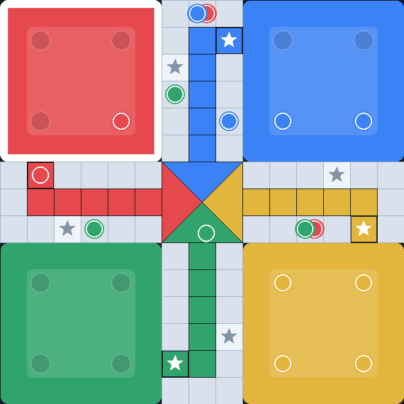

# Ludo 🎲

Jeu de Ludo multijoueur en ligne, écrit en **Elixir / Phoenix** et livré dans une
**image Docker**. Pas de compte à créer : on choisit un pseudo et on joue.

* **Modes** : solo contre l'IA, 2, 3 ou 4 joueurs
* **Temps réel** : WebSockets (canaux Phoenix), aucun rechargement de page
* **Aucune base de données** : les parties vivent en mémoire
* **Aucune dépendance front** : ni npm, ni esbuild, ni Tailwind — le client
  Phoenix officiel est vendorisé et le plateau est dessiné en SVG

## Démarrage rapide (Docker)

```bash
git clone https://github.com/davidagoua/jeu-ludo.git
cd jeu-ludo
docker compose up -d --build
```

Ouvrez ensuite <http://localhost:4000>. Aucune variable d'environnement n'est
obligatoire : le conteneur démarre tel quel.

Pour changer le port exposé :

```bash
LUDO_PORT=8080 docker compose up -d --build
```

### Sans Docker

```bash
mix deps.get
mix phx.server      # http://localhost:4000
```

Testé avec Elixir 1.19.3 / OTP 28 et Phoenix 1.8.

## Comment on joue

1. Sur l'accueil, saisissez un **pseudo**, choisissez un **mode** et cliquez sur
   *Créer la partie*.
2. Partagez le **code du salon** (4 caractères) ou le lien de la page : les
   autres joueurs rejoignent avec ce code, ou via *Rejoindre une partie ouverte*.
3. La partie démarre **dès que tous les sièges sont pris**. L'hôte peut aussi
   cliquer sur *Compléter avec des IA et démarrer* pour ne pas attendre.
4. Cliquez sur **Lancer le dé**, puis sur un pion mis en surbrillance.

La **zone du joueur dont c'est le tour s'illumine** sur le plateau, et le dé est
affiché en points : il tourne sur lui-même pendant que le serveur répond, puis
claque sur la valeur tirée.

Un joueur qui recharge la page **reprend automatiquement son siège** : son
identifiant est conservé dans le `localStorage` du navigateur, il n'y a donc
aucun compte à créer.

## Disposition du plateau



*Image produite depuis le SVG que le client génère réellement, lui-même construit
à partir de `Ludo.Board.geometry/0`.*

| Joueur | Base | Colonne d'arrivée | Case de départ |
| --- | --- | --- | --- |
| rouge | haut-gauche | bras gauche | `(1,6)` |
| bleu | haut-droite | bras haut | `(8,1)` |
| jaune | bas-droite | bras droit | `(13,8)` |
| vert | bas-gauche | bras bas | `(6,13)` |

L'anneau compte 56 cases. La case de départ se situe **deux** cases après
l'entrée de la colonne d'arrivée du même joueur : sortir de sa base et rentrer
chez soi sont deux cases distinctes, en diagonale — c'est la disposition du
plateau classique. Un pion parcourt donc 54 cases d'anneau, puis 5 cases de
colonne, avant l'arrivée.

Les huit **cases sûres** sont les quatre départs (cases colorées, étoile
blanche) et les quatre cases étoile situées 9 cases plus loin (étoile grise).

## Règles appliquées

* Un **6** est nécessaire pour sortir un pion de sa base.
* Atterrir sur un pion adverse le **renvoie à sa base**, sauf sur une **case
  sûre** (les quatre départs et les quatre cases étoile).
* Un **6**, une **capture** ou un **pion arrivé** donnent un tour supplémentaire.
* **Trois 6 d'affilée** annulent le tour.
* Il faut le **compte exact** pour atteindre le centre.
* Le premier joueur à rentrer ses **quatre pions** gagne.

Deux choix sont assumés et documentés dans `Ludo.Game` :

* les **blocs** ne sont pas appliqués (deux pions d'un même joueur peuvent
  partager une case, et les adversaires peuvent passer) ;
* la partie s'arrête au **premier vainqueur** (pas de classement complet).

Si un joueur ne joue pas pendant **60 secondes**, le serveur joue à sa place :
une partie ne reste jamais figée.

## Architecture

```
lib/ludo/
  board.ex        géométrie du plateau (anneau de 56 cases, colonnes, bases)
  game.ex         état et règles — module pur, entièrement testable
  bot.ex          IA : évalue chaque coup légal, puis tire parmi les meilleurs
  lobby.ex        registre des parties, génération des codes de salon
  game_server.ex  un GenServer par partie (seul écrivain de l'état)
lib/ludo_web/
  channels/       socket, canal d'accueil, canal de partie
  controllers/    accueil, plateau, règles, sonde /sante
priv/static/assets/
  css/ludo.css    styles écrits à la main
  js/app.js       client : Socket Phoenix, plateau SVG, rendu de l'état
  js/phoenix.min.js  client Phoenix officiel (vendorisé depuis Hex)
```

Quelques partis pris qui expliquent la structure :

* **`Ludo.Game` est pur.** Aucune fonction ne modifie l'état en place et le dé
  peut être injecté (`roll/3`) : les règles sont donc testables de façon
  déterministe, sans horloge ni aléatoire.
* **Un processus par partie.** Toutes les actions passent par des `call`
  adressés au `GameServer`, ce qui supprime toute condition de course entre
  joueurs d'un même salon.
* **La géométrie vient du serveur.** `Ludo.Board.geometry/0` est envoyée au
  navigateur à la connexion : le JavaScript ne connaît aucune coordonnée et il
  n'existe qu'une seule source de vérité pour la forme du plateau.

## Tests

```bash
mix test                      # 139 tests : règles, IA, lobby, canaux

# serveur lancé (mix phx.server ou docker compose up)
node scripts/ws_smoke.mjs     # 29 vérifications en WebSocket réel

# client navigateur, sans navigateur
mix run -e 'IO.puts(Jason.encode!(Ludo.Board.geometry()))' 2>/dev/null | tail -1 > /tmp/geometry.json
node scripts/geometry_check.mjs /tmp/geometry.json   # 40 vérifications
```

`mix test` couvre notamment la géométrie (boucle fermée, symétrie des départs,
parcours continu d'un pion), les règles (sortie de base, captures, cases sûres,
compte exact, trois 6, victoire) et les canaux (sièges, reconnexion, refus des
coups illégaux, diffusion de l'état).

`scripts/ws_smoke.mjs` parle le protocole des canaux Phoenix en direct, sans
navigateur : il crée une partie, connecte deux joueurs, vérifie les refus, joue
jusqu'à un vainqueur, teste la reconnexion et laisse les IA jouer seules. Ni
l'un ni l'autre n'ont besoin de dépendance (Node 22+).

`scripts/geometry_check.mjs` charge `app.js` avec un DOM factice et lui injecte
la géométrie réelle du serveur : il vérifie que chaque position de pion tombe sur
la bonne case, que le plateau se construit et que les quatre états se rendent
sans exception. C'est ce qui permet de tester le client sans navigateur.

## Configuration

Toutes les variables sont facultatives.

| Variable | Défaut | Rôle |
| --- | --- | --- |
| `PORT` | `4000` | port d'écoute dans le conteneur |
| `LUDO_PORT` | `4000` | port publié par `docker compose` |
| `PHX_HOST` | `localhost` | hôte public (URL absolues) |
| `PHX_SCHEME` | `http` | `https` derrière un reverse proxy TLS |
| `CHECK_ORIGIN` | `false` (compose) | origines autorisées pour les WebSockets |
| `SECRET_KEY_BASE` | tiré au démarrage | clé de signature des cookies |

`CHECK_ORIGIN` mérite une explication : Phoenix refuse par défaut les WebSockets
dont l'origine ne correspond pas à `PHX_HOST`. En accès direct par IP locale ou
derrière un reverse proxy, le navigateur envoie une autre origine et la connexion
serait coupée. Le fichier `docker-compose.yml` désactive donc cette vérification
(`CHECK_ORIGIN=false`) ; en production exposée, préférez une liste explicite :

```yaml
CHECK_ORIGIN: "ludo.mondomaine.fr"
```

## Limites connues

* **Un seul nœud.** Les parties vivent dans la mémoire du nœud : le jeu ne
  s'échelonne pas horizontalement en l'état. Il faudrait un stockage partagé
  (Redis, ETS distribué) et `Phoenix.PubSub` en mode distribué.
* **Pas de compte.** Quiconque connaît un code de salon peut y entrer, et
  l'identifiant de joueur n'est pas un secret : c'est voulu pour un jeu entre
  amis, pas pour un classement compétitif.
* **Les parties terminées sont oubliées** au bout de quelques minutes
  (nettoyage automatique dans `Ludo.Lobby`).

## Licence

MIT
